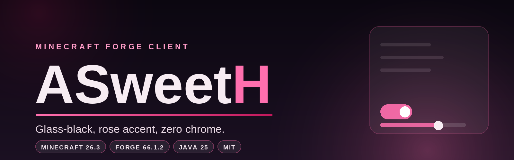
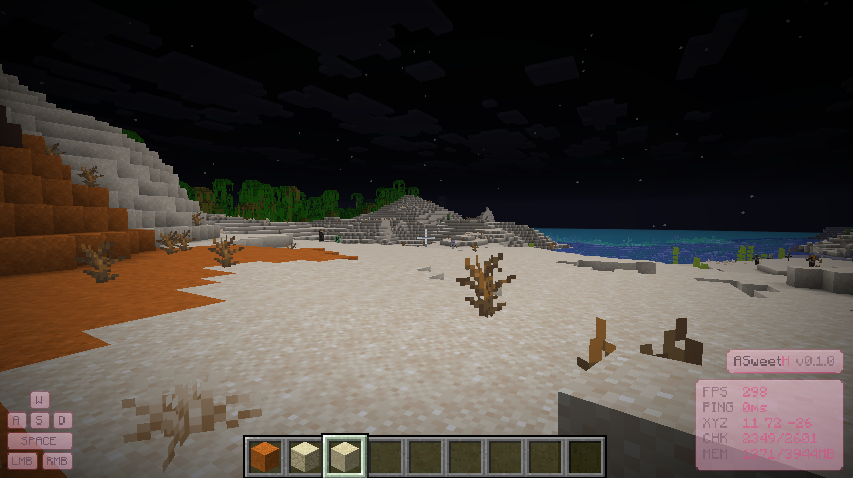
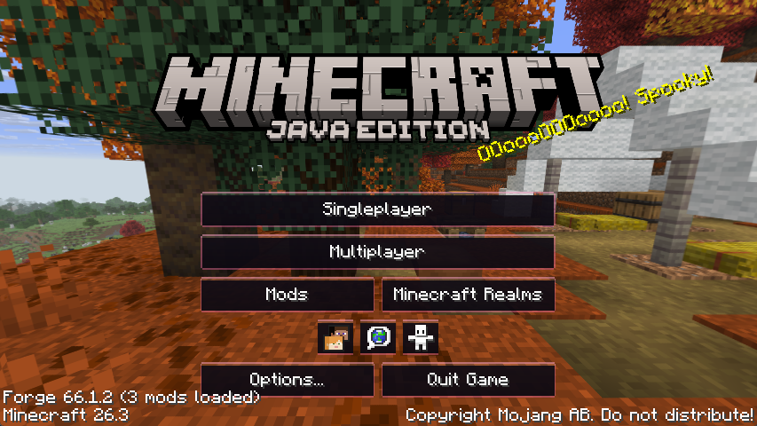
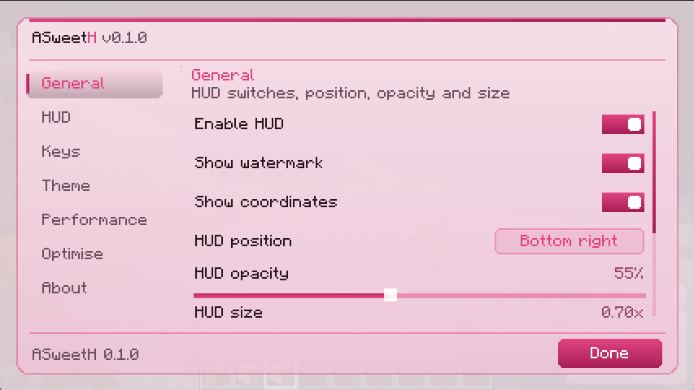
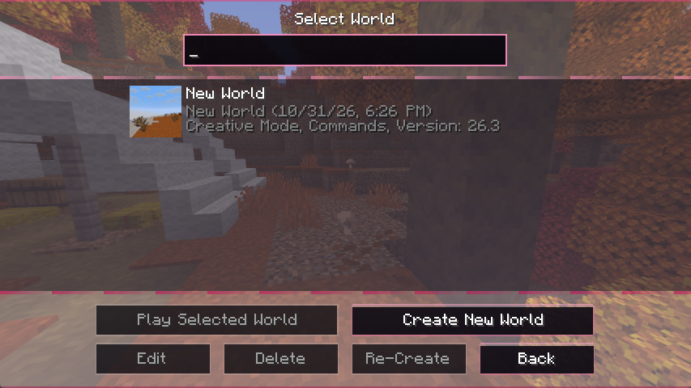
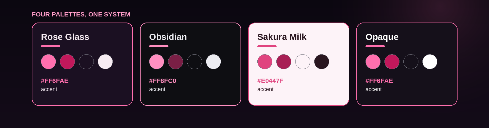

<div align="center">



# ASweetH

**A glass-black, rose-accented client layer for Minecraft 26.3 on Forge.**
One jar. No libraries to install, no server side, no rewrite of the game — just a client that looks
and feels like it belongs to 2026.

[](https://www.minecraft.net/)
[](https://files.minecraftforge.net/)
[](https://adoptium.net/)
[](LICENSE)

[](https://github.com/grivia0/AsweetH/releases)
[](#compatibility)
[](https://github.com/grivia0/AsweetH/actions/workflows/build.yml)

[**⬇ Download**](https://github.com/grivia0/AsweetH/releases) · [**Screenshots**](#-screenshots) · [**Features**](#-features) · [**Install**](#-install) · [**Controls**](#-controls) · [**Config**](#-configuration) · [**Build**](#-build-from-source)

</div>

---

> [!NOTE]
> ASweetH is a **client-side** mod: it registers HUD layers, key binds and one mixin. It never sends a
> packet or changes the world for anyone else, so it is safe on any server you already play on.

## 📷 Screenshots

Captured on Forge 66.1.2 / Minecraft 26.3 with the **Sakura Milk** palette — the light glass variant.
Rose Glass, the default, is the dark smoked one from the banner.

<table>
  <tr>
    <td align="center" width="50%"><br>
      <sub><b>In game</b> — keystrokes bottom left, watermark and readouts bottom right, all through the HUD layer</sub></td>
    <td align="center" width="50%"><br>
      <sub><b>The title screen</b> — the menus are vanilla's; the glass buttons and rose edges are ASweetH's</sub></td>
  </tr>
  <tr>
    <td align="center" width="50%"><br>
      <sub><b>Right Shift</b> — seven tabs, scrollable rows, live values, every control themed</sub></td>
    <td align="center" width="50%"><br>
      <sub><b>World select</b> — vanilla layout, glass sprites, accent hairline top and bottom</sub></td>
  </tr>
</table>

## 🖤 At a glance

|  |  |
|:--|:--|
| **A HUD that matches the game**<br>Watermark plus FPS, ping, coordinates, chunk count and memory. Nine-way anchor grid, 0.6–1.8× scale, opacity, and a switch per row — so it never fights your hotbar. | **Hold-to-zoom that keeps working**<br>`C` glides the field of view to your factor (1.5–10×) and back. The FOV is *divided* rather than overwritten, so sprinting, water and the death screen survive a zoom. |
| **Fullbright, done at the source**<br>One switch lights unlit caves and the Nether floor without a resource pack, particles or a green tint — it writes the lightmap uniforms vanilla already uses. | **An Optimise tab with real teeth**<br>Lookup-table maths, batched glass panels, cached readouts and an adaptive render distance that steps down to hold your target FPS. |
| **Keystrokes worth looking at**<br>WASD / space / mouse caps with the same anchor, scale, opacity and colour controls as the HUD. | **Presets that stay honest**<br>Standard, Lite, Potato and Max view write real vanilla options — the vanilla video settings screen shows exactly what changed. |

## 🎨 The look

Four complete palettes, every colour from one enum. Switch the theme and the HUD, the widgets and the
vanilla screen tint all follow, because nothing in the render path hardcodes a colour.



**Rose Glass** (default) · **Obsidian** (pink only where it means something) · **Sakura Milk**
(a light glass for daytime play) · **Opaque** (no translucency at all — for screenshots and
low-contrast displays).

## 📦 Install

| | |
|:--|:--|
| **Minecraft** | 26.3 (client) |
| **Loader** | Forge 66.1.2 or newer on the 66 line |
| **Java** | 25 — the runtime that ships with 26.x |
| **Side** | Client only — marked `clientSideOnly` in `mods.toml`, so it is skipped on a dedicated server |

1. Install **Forge 26.3** and launch it once, so the launcher creates the instance.
2. Drop `asweeth-0.1.0.jar` into that instance's `mods/` folder
   (`%APPDATA%\.minecraft\mods` on Windows, `~/.minecraft/mods` on Linux and macOS).
3. Start the game. The HUD appears in the top left, and **Right Shift** opens the menu.

> [!TIP]
> **[Download `asweeth-0.1.0.jar`](https://github.com/grivia0/AsweetH/releases/download/v0.1.0/asweeth-0.1.0.jar)** —
> 93 kB, no dependencies. 0.1.0 is published as a **pre-release**: the jar is complete and playable, the
> label only means the feature set can still move before 0.1.1. Building it yourself is one command as
> well — see [Build from source](#-build-from-source) — and CI attaches a jar to every workflow run.

Settings live in `config/asweeth.json` next to the other mods' configs and are written on every
change, so a crash never eats them. Deleting the file is a full reset.

## ⌨️ Controls

| Key | Action |
|:--|:--|
| <kbd>Right Shift</kbd> | Open the ASweetH menu |
| <kbd>H</kbd> | Toggle the HUD |
| <kbd>K</kbd> | Toggle the keystrokes |
| <kbd>L</kbd> | Cycle preset: Standard → Lite → Potato → Max view |
| <kbd>C</kbd> | Zoom while held (factor set in the Keys tab) |
| <kbd>J</kbd> | Copy your block coordinates to the clipboard |

All six live in their own **ASweetH** category in *Options → Controls → Key Binds*, so they rebind like
any vanilla key.

## ✨ Features

### HUD & keystrokes

A compact watermark plus readout panel, anchored to any of **nine** positions on the screen.

* `ASweetH v0.1.0` wordmark, trailing **H** in the accent colour, gradient underline.
* Rows for **FPS**, **ping**, **coordinates**, **chunks** and **memory**, each switchable on its own.
* A badge with the active profile (`Lite`, `Potato`, `Max view`) beside the version — only shown while
  something other than Standard is applied.
* **Anchor**, **opacity** (20–100 %) and a uniform **size** slider (0.6–1.8×), plus a master switch.

The block measures itself first and only then picks its origin, so anchoring and scaling never clip: a
1.8× HUD still hugs the edge it is pinned to, and the narrower panel right-aligns with the other one.
Opacity fades outlines, fills, the accent bar and the glyphs together. It is drawn through
`AddGuiOverlayLayersEvent`, so it is a real HUD layer rather than a render hack, and it behaves like
vanilla overlays around open screens.

The keystroke readout (`WASD`, space, mouse) has its own anchor, size, opacity and tint, so the two
blocks can share a corner or get out of each other's way.

### Zoom

Hold <kbd>C</kbd> and the field of view glides to the factor from the Keys tab (1.5×–10×); release and
it glides back.

<details>
<summary>Why it does not break sprinting or water</summary>

The lens is stepped in `ViewportEvent.ComputeFov`, once per frame, so it moves at the framerate instead
of at the client tick's 20 Hz. The FOV is **divided** by the factor instead of being overwritten, which
keeps every other FOV effect — sprinting, the underwater squeeze, the death screen zoom — intact while
you are zoomed in.

</details>

### Fullbright

A **Fullbright** switch in the General tab lifts the level lighting, so unlit caves, tunnels and the
Nether floor are as visible as with a night vision potion — no particles, no green tint, no resource
pack.

<details>
<summary>How it works (and why the gamma slider cannot do this any more)</summary>

26.3 validates `options.gamma()` to 0–1, and the value only feeds `state.brightness`, which the shader
applies as a *curve* on light that is already there — a pitch black cave stays black. The mixin
(`LightmapRenderStateExtractorMixin`) instead writes two uniforms of the lightmap render state after
vanilla has filled it in:

```java
@Inject(method = "extract", at = @At("TAIL"))
private void asweeth$applyFullbright(LightmapRenderState state, float partialTick, CallbackInfo callback) {
    if (!ClientSettings.get().fullbright) {
        return;
    }
    state.nightVisionEffectIntensity = FULL_BLEND;      // 1.0F -> raise the floor: lights unlit blocks
    state.brightness = FULL_BRIGHTNESS;                 // 1.0F -> full notGamma: mid grey turns near white
}
```

What the shader actually mixes (`lightmap.fsh`) is
`color = max(Ambient, NightVision * NVFactor) + sky * skyBrightness + block * blockBrightness`, then
`mix(color, notGamma(color), BrightnessFactor)`. Both uniforms are needed: night vision on its own
stops at a dim 0.6 grey.

Nothing else is touched — fog colours, the darkness effect, boss darkening and the dimension's own
night vision tint keep working, and the injection sits at `TAIL` so the early return taken when the
lightmap does not need an upload is left alone. The flag is read per frame, so the switch applies
within a tick without touching the render pipeline.

</details>

### Settings screen

Press **Right Shift** in game. A glass sheet with a vertical tab rail and a footer that always knows
which version you are on.

| Tab | What it holds |
|:--|:--|
| **General** | HUD master switch, watermark, coordinates, HUD position, opacity, size, fullbright |
| **HUD** | FPS, ping, memory, chunk and preset-badge rows |
| **Keys** | keystroke switches, position, size, opacity, colour scheme, zoom factor |
| **Theme** | palette cycle button, animations, live swatches of every theme |
| **Performance** | preset cycle button, apply button, description of the selected profile |
| **Optimise** | maths, panel batching, readout caching, smart culling, menu blur, streaming aid, target FPS |
| **About** | version, Minecraft version, Forge version, current palette |

Rows live in a scroll area, so nothing is ever clipped by the sheet: whatever does not fit scrolls with
the wheel behind a two-pixel accent scrollbar. Each tab remembers its own offset, so switching back and
forth does not throw you back to the top.

Every widget is a real `AbstractWidget` (`GlassButton`, `GlassToggle`, `GlassSlider`, `GlassCycleButton`,
`TabButton`), so keyboard navigation, narration and focus handling come from vanilla instead of being
reimplemented badly. ASweetH also registers a `ConfigScreenHandler.ConfigScreenFactory`, which gives
*Options → Mods* a working **Config** button.

### Vanilla screens

The glass does not stop at the HUD. The jar replaces a handful of **vanilla** GUI resources — the menu
background tiles and their in-world variants, the four header/footer separator strips, and the widget
sprite set (`button`, `button_highlighted`, `button_disabled`, `slider`, `slider_highlighted`,
`slider_handle`, `tab`, `tab_selected`, `text_field` and their highlighted states) — so the title
screen, world select, pause menu, options and every other vanilla screen inherits the look with no
resource pack to install and nothing to enable.

On top of that, `ClientEvents.onScreenBackground` paints one palette gradient and a hairline accent
frame over the background of every vanilla screen (`themeVanillaScreens`, Theme tab). That gradient is
deliberately faint over the title-screen panorama and stronger over in-world screens, and it is the part
the switch turns off — the sprites are resource overrides and stay, the tint and the frame go.

### Performance presets

Vanilla's graphics preset only covers a handful of switches, so ASweetH writes the individual options
and saves `options.txt` afterwards — the vanilla video settings screen shows exactly what was touched.

| Preset | Render | Sim | Entities | Particles | Clouds | Mipmaps | Biome blend | AO | View bob |
|:--|--:|--:|--:|:--|:--|--:|--:|:--|:--|
| **Standard** | 12 | 10 | 1.00 | all | fancy | 4 | 2 | on | on |
| **Lite** | 8 | 6 | 0.75 | decreased | fast | 2 | 1 | on | on |
| **Potato** | 5 | 4 | 0.50 | minimal | off | 0 | 0 | off | off |
| **Max view** | 32 | 8 | 0.70 | decreased | off | 2 | 0 | on | on |

*Max view* is the interesting one: the maximum radius only stays playable if chunk **building** gets
cheaper, so it turns down fade-in, entity shadows, biome blending and menu blur instead of the draw
distance.

### Optimise

Real switches, not always-on magic:

| Switch | What it actually does |
|:--|:--|
| **Fast maths** | Lookup-table exponentials and fixed-point colour maths instead of a libm call per vertex. |
| **Fast panels** | Collapses the straight part of every glass panel into a single gradient quad. |
| **Cached readouts** | Rebuilds the FPS / ping / memory strings a few times a second instead of every frame. |
| **Smart culling** | Keeps vanilla's entity and AABB culling on (switchable for parity testing). |
| **Fast menus** | Drops the menu background blur, which costs milliseconds per frame while a screen is open. |
| **Chunk streaming aid** | Removes chunk fade-in churn and caps biome blending at high render distances. |
| **Adaptive render distance** | Steps the render distance down — and back up — to hold the target FPS (30–360). |

## ⚙️ Configuration

Everything is in the menu, and everything is also a key in `config/asweeth.json`:

```json
{
  "theme": "ROSE_GLASS",
  "preset": "STANDARD",
  "hudEnabled": true,
  "hudAnchor": "TOP_LEFT",
  "hudScale": 1.0,
  "hudOpacity": 1.0,
  "fullbright": false,
  "zoomFactor": 4.0,
  "targetFps": 120
}
```

| Key | Values | Default |
|:--|:--|:--|
| `theme` | `ROSE_GLASS`, `OBSIDIAN`, `SAKURA_MILK`, `OPAQUE` | `ROSE_GLASS` |
| `preset` | `STANDARD`, `LITE`, `POTATO`, `MAX_VIEW` | `STANDARD` |
| `hudEnabled`, `keystrokesEnabled` | bool | `true` |
| `showWatermark`, `showCoordinates`, `showChunks`, `showFps`, `showPing`, `showLiteBadge` | bool | `true` |
| `showMemory` | bool | `false` |
| `keystrokesMouse` | bool | `true` |
| `hudAnchor`, `keystrokeAnchor` | `TOP_LEFT` … `BOTTOM_RIGHT` (nine anchors) | `TOP_LEFT` / `BOTTOM_LEFT` |
| `hudScale`, `keystrokeScale` | `0.6` – `1.8` | `1.0` |
| `hudOpacity`, `keystrokeOpacity` | `0.2` – `1.0` | `1.0` / `0.9` |
| `keystrokeTint` | `THEME`, `ACCENT`, `MONO` | `THEME` |
| `animations`, `themeVanillaScreens` | bool | `true` |
| `zoomFactor` | `1.5` – `10.0` | `4.0` |
| `fullbright` | bool | `false` |
| `fastMath`, `fastPanels`, `cacheReadouts`, `smartCulling`, `fastMenus`, `chunkStreamAid` | bool | `true` |
| `adaptiveRenderDistance` | bool | `false` |
| `targetFps` | `30` – `360` | `120` |

> [!NOTE]
> Hand-edited values are sanitised on load: out-of-range numbers are clamped, unknown enum names fall
> back to the default, and a missing key keeps the default instead of collapsing to `0`. If you edit the
> file while the game is running, the next launch picks it up — or use the menu, which saves instantly.

## 🔨 Build from source

```bash
git clone https://github.com/grivia0/AsweetH.git
cd AsweetH
./gradlew build          # jar lands in build/libs/asweeth-0.1.0.jar
./gradlew runClient      # dev launch, no launcher needed
```

A **JDK 25** toolchain is required. The build sets `java.toolchain.languageVersion = 25`, matching the
Java version Minecraft 26.3 ships with, and `gradle/gradle-daemon-jvm.properties` pins the Gradle daemon
to the same major version — Gradle 9.7 cannot compile build scripts on a newer JDK, so a launcher JVM of
27 would otherwise fail with `Unsupported class file major version 71`.

<details>
<summary>Project layout</summary>

```
src/main/java/dev/asweeth/
├── AsweetH.java                  mod entry point, logger, shared constants
├── client/
│   ├── AsweetHClient.java        MOD bus: startup log, Fabric jar check, mods list entry
│   ├── ClientEvents.java         GAME bus: key bindings, HUD layer, per-tick keys
│   ├── KeyBinds.java             ASweetH key mapping category
│   ├── Zoom.java                 hold-to-zoom lens driven by ComputeFov
│   ├── FabricModCheck.java       warns about Fabric jars Forge cannot load
│   ├── hud/                      AsweetHHud, KeystrokesHud, HudAnchor, KeystrokeTint
│   ├── perf/                     PerformancePreset, Optimisations
│   ├── screen/                   AsweetHScreen, SettingsTab
│   └── widget/                   glass widgets, ScrollPanel, HintBlock
├── config/ClientSettings.java    Gson persistence in config/asweeth.json
├── mixin/                        LightmapRenderStateExtractorMixin (fullbright)
├── theme/                        ThemeMode palette, Theme accessor
└── util/                         Colours, Easing, FastMath, Render2D
```

`asweeth.mixins.json` lists the mixin config; `build.gradle` adds it to the jar manifest
(`MixinConfigs`) and to the dev launch arguments. `docs/make_assets.py` regenerates the banner and the
palette sheet from the colours in `ThemeMode`.

</details>

<details>
<summary>Notes on 26.3 (extract-phase GUI, official names, mixin warnings)</summary>

The GUI in 26.3 is **extract based**: screens and HUD layers fill in a `GuiRenderState` through
`GuiGraphicsExtractor` instead of drawing immediately. ASweetH therefore avoids custom render pipelines
entirely — rounded corners and glass panels are built from per-row `graphics.fill` calls in `Render2D`,
which keeps the mod compatible with whatever the renderer does next. Screens are switched through
`Minecraft.gui.setScreen(...)`, and mouse handlers receive a `MouseButtonEvent` rather than raw
coordinates.

Forge 26.3 runs mods on **Mojang official names**, so nothing has to be remapped: the mixin config
carries no refmap, and the Mixin annotation processor is intentionally absent (its target validation only
knows searge/notch mappings and would fail the build).

Mixin 0.8.7 predates Java 25 class files, so with `-Dmixin.debug.verbose=true` (or in `logs/debug.log`)
it adds two compatibility notes about the fullbright mixin: the config asks for `JAVA_21` while this
version of Mixin supports `JAVA_13`, and the mixin class itself is version 69 where Mixin can emit 65.
They describe the toolchain rather than the mod — application is logged as
`Mixing LightmapRenderStateExtractorMixin ... into ...LightmapRenderStateExtractor`, and
`-Dmixin.debug.export=true` writes the transformed class out so it can be checked with `javap`. A normal
launch says nothing about it.

</details>

## 🔗 Compatibility

* **Client-side only.** It never talks to the server, so there is nothing to install there and nothing
  server-side that could object to it being loaded.
* **No libraries.** No Architectury, no Fabric API, no third-party GUI toolkit — just Forge and the mod.
* **Other Forge mods.** ASweetH adds one mixin, at the tail of the lightmap extractor; anything that
  replaces that method wholesale is the only realistic conflict, and with Fullbright off the injection
  returns immediately.

<details>
<summary>Can I run Fabric mods next to it?</summary>

Forge cannot load Fabric mods at all. The only bridge is
[Sinytra Connector](https://github.com/Sinytra/Connector), which is a **NeoForge** compatibility layer —
its support matrix lists Minecraft 26.2/26.1, 1.21.1 (LTS) and 1.20.1 (EOL), with no Forge and no 26.3
build, so dropping the Fabric API jar into this instance's `mods/` folder cannot work.

The routes that do work: stay on Forge 26.3 and use Forge ports of the mods you want, port ASweetH to
NeoForge 26.2 and add Connector, or build a multiloader layout (Architectury or a common/Fabric/Forge
split). ASweetH is not silent about it either: `FabricModCheck` scans `mods/` on startup, reads each
jar's `fabric.mod.json` and logs the mod name, version and id plus that explanation — Forge ignores such
jars without a word, so without this line the only symptom is a mod that quietly is not there.

</details>

## 🩹 Troubleshooting

| Symptom | Fix |
|:--|:--|
| The HUD is not on screen | <kbd>H</kbd>, or *General → HUD* — and check the opacity slider is not at 20 % against a dark sky. |
| Fullbright does nothing | It is off by default; turn it on in *General → Fullbright*. |
| `Unsupported class file major version 71` while building | Gradle is running on a JDK newer than 25; the daemon pin handles it, so check that `gradle/gradle-daemon-jvm.properties` survived your clone. |
| My settings reset | `config/asweeth.json` was deleted or unreadable — ASweetH logs one line and starts from defaults instead of refusing to load. |
| Another mod's screen looks odd | ASweetH overrides vanilla GUI sprites, so any screen built from them is repainted. *Theme → theme vanilla screens* drops the gradient and accent frame; **Opaque** shows the sprites without translucency. |

## 📄 License & credits

MIT — see [LICENSE](LICENSE). Do what you want with it; a link back is appreciated.

* Built with **ForgeGradle 7** on the official MDK layout. Minecraft Forge itself is licensed under
  **LGPL 2.1** — that license covers Forge, not this mod.
* Palettes, widgets and the HUD are original work. The sprite set under
  `assets/minecraft/textures/gui/` is a rose-glass re-colour of Mojang's GUI textures, shipped only as a
  resource pack inside the jar.
* Not affiliated with Mojang, Microsoft or the MinecraftForge team.

<div align="center">

**If ASweetH makes your client nicer, a ⭐ helps other people find it.**

</div>
